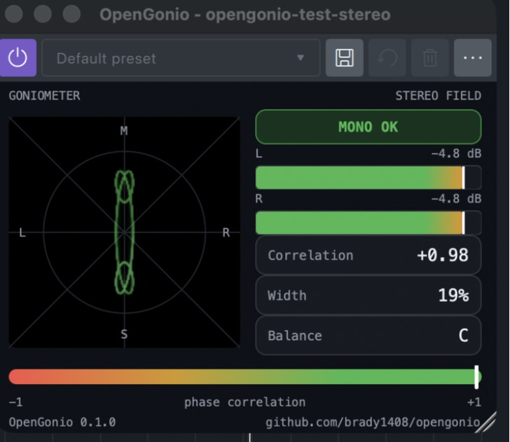

# OpenGonio

Free, open-source goniometer, Lissajous / vectorscope and stereo field meter for Audacity and any VST3, AU or LV2 host.

[](https://ko-fi.com/bradycole)
[](https://github.com/brady1408/opengonio/actions/workflows/build.yml)




One small window that answers the questions a stereo track raises: is it in phase, will it survive a mono fold-down, is one channel inverted or missing, and is it balanced. No account, no bundle, no newsletter, no telemetry. Install it, open your DAW, press play.

## Install

Download the file for your system from the [latest release](https://github.com/brady1408/opengonio/releases/latest).

### macOS (VST3 + AU, universal, macOS 11+)

Run `OpenGonio-<version>-macOS.pkg`. It installs `OpenGonio.vst3` and `OpenGonio.component` into `/Library/Audio/Plug-Ins`. Quit Audacity first when upgrading.

**This 0.1.0 build is not yet notarized.** macOS may say the installer "cannot be opened because it is from an unidentified developer", or Audacity may report the plugin as damaged or blocked. Either:

- Right-click the `.pkg` and choose **Open**, then **Open** again in the dialog; or
- Open **System Settings → Privacy & Security**, scroll down, and click **Open Anyway** next to the OpenGonio message; or
- In Terminal, clear the quarantine flag after installing:

```bash
xattr -dr com.apple.quarantine /Library/Audio/Plug-Ins/VST3/OpenGonio.vst3 /Library/Audio/Plug-Ins/Components/OpenGonio.component
```

Signing and notarization are planned for 0.2.0.

### Windows (VST3, 64-bit, Windows 10+)

Run `OpenGonio-<version>-Windows-Setup.exe`. It installs `OpenGonio.vst3` into `C:\Program Files\Common Files\VST3`. Close Audacity (or any DAW with OpenGonio loaded) first when upgrading, since a loaded plugin file cannot be replaced.

**SmartScreen may show "Windows protected your PC".** Click **More info → Run anyway**. The build is not code-signed yet.

Prefer no installer? `OpenGonio-<version>-Windows-VST3.zip` holds the bare `OpenGonio.vst3` folder; copy it into `C:\Program Files\Common Files\VST3`.

### Linux (VST3 + LV2, x86_64)

Extract `OpenGonio-<version>-Linux.tar.gz` and run `./install.sh`, which copies the bundles into `~/.vst3` and `~/.lv2`.

Linux builds are produced by CI but **untested by the author**; reports and fixes are welcome.

## Using it in Audacity

OpenGonio is a realtime effect, so it lives in the Effects panel rather than the Analyze menu.

1. After installing, open **Effect → Plugin manager** and click **Rescan plugins** if OpenGonio is not listed yet.
2. Select a track and click **Effects** in its header (or **View → Show effects panel**).
3. Click **Add effect → VST3 → Brady Cole → OpenGonio** (on macOS, AudioUnit works too).
4. Press play. The window updates live and the audio passes through untouched.

Tested with Audacity 4.0.1. Any VST3, AU or LV2 host should work the same way.

## What the display means

- **Goniometer.** Left and right plotted against each other, rotated 45°. A mono signal draws a vertical line, a wide stereo image a round cloud, an inverted channel a horizontal line, and a single channel a diagonal leaning toward L or R. ±1 spans the box at the fixed scale; click **AUTO** in the scope's corner to normalize quiet material.
- **Status light.** `MONO OK` (correlation above +0.1), `CAUTION` (between −0.2 and +0.1), `PHASE ISSUE` (below −0.2), `NO SIGNAL`, and `L ONLY` / `R ONLY` when one channel is silent. Each state must hold for half a second before the light changes, so it does not flicker. These thresholds are a starting point; if your experience says they should sit elsewhere, [open an issue](https://github.com/brady1408/opengonio/issues).
- **L / R meters.** Sample-peak level in dBFS with a 1.5 s peak-hold tick; the bar end turns red for 2 s after a sample above −0.1 dBFS.
- **Correlation.** Phase correlation over a 300 ms window: +1 identical, 0 unrelated, −1 inverted. The bar below repeats it on a −1 to +1 scale.
- **Width.** 0 % for mono, about 100 % for a fully uncorrelated image, up to 200 % for out-of-phase material.
- **Balance.** RMS level difference between channels, or `C` when within 0.1 dB.

With the transport stopped the trace fades, the meters fall and the status light goes quiet; the correlation, width and balance readouts hold their last value.

## Build from source

Requires CMake 3.22+ and a C++20 compiler (Xcode command line tools, Visual Studio 2022, or GCC 12+). JUCE 9.0.4 and Catch2 are fetched automatically.

```bash
cmake -B build -DCMAKE_BUILD_TYPE=Release
cmake --build build --config Release -j
ctest --test-dir build -C Release --output-on-failure
```

Built plugins land in `build/OpenGonio_artefacts/Release/` and are copied into your user plugin folders (pass `-DOPENGONIO_COPY_PLUGIN=OFF` to skip that). On Linux you need the usual JUCE development packages; see `.github/workflows/build.yml` for the list.

## Support

OpenGonio is free and will stay that way. If it saved you a bad delivery, you can [buy the next round on Ko-fi](https://ko-fi.com/bradycole). Issues and pull requests are just as welcome.

## License

AGPL-3.0-or-later. See [LICENSE](LICENSE). Built with [JUCE](https://juce.com), used under the AGPLv3.
